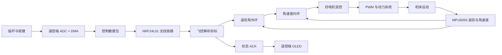
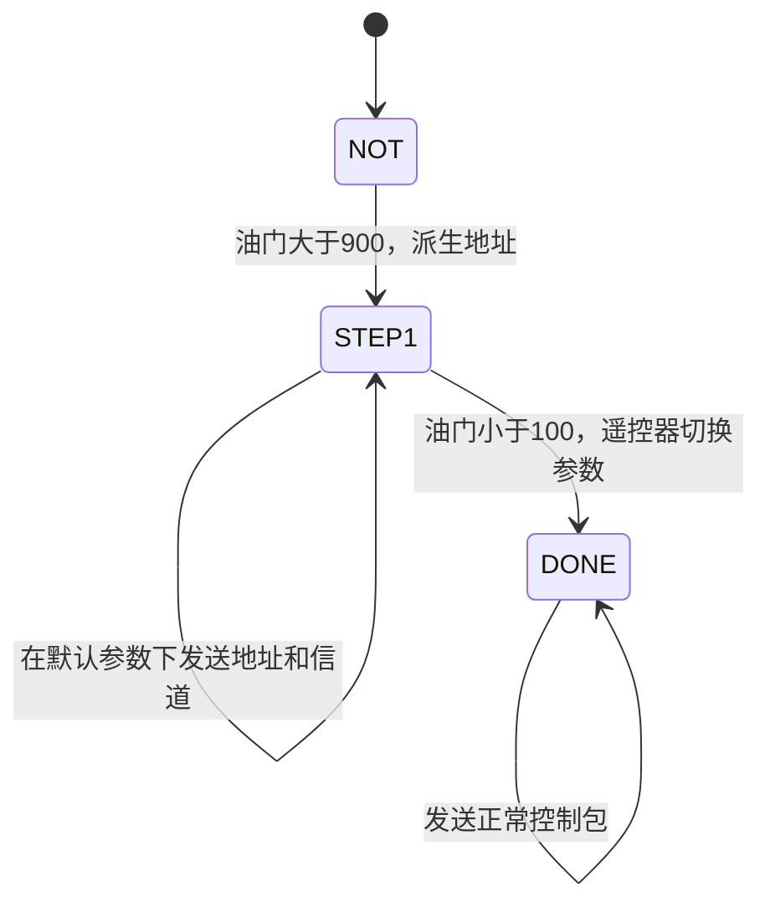

# STM32 四轴飞控与遥控器：项目学习与实战教程

> 面向对象：掌握 C 语言基础、希望通过实际工程学习嵌入式与飞行控制的学生。
>
> 编写日期：2026-11-09。源码基线：`7db9a5a5ef03e9486bb04695eb0db1c2aeee18a5`。
>
> 本文依据当前源码编写，未进行硬件接线、固件构建或实机飞行验证。文中的频率与时间除特别说明外，均为配置值或理论推算值。

## 目录

1. [怎样使用本教程](#一怎样使用本教程)
2. [建立系统全貌](#二建立系统全貌)
3. [准备环境与阅读代码](#三准备环境与阅读代码)
4. [遥控端：从摇杆到数据包](#四遥控端从摇杆到数据包)
5. [无线链路：协议、ACK 与对频](#五无线链路协议ack-与对频)
6. [飞控端：理解时间与调度](#六飞控端理解时间与调度)
7. [传感器与姿态估计](#七传感器与姿态估计)
8. [串级 PID 控制](#八串级-pid-控制)
9. [电机混控与 PWM](#九电机混控与-pwm)
10. [状态、保护、调参与参数保存](#十状态保护调参与参数保存)
11. [当前代码的问题与学习边界](#十一当前代码的问题与学习边界)
12. [分阶段实验](#十二分阶段实验)
13. [故障排查](#十三故障排查)
14. [课程作业与验收](#十四课程作业与验收)
15. [自测题与参考答案](#十五自测题与参考答案)
16. [术语与源码索引](#十六术语与源码索引)

## 一、怎样使用本教程

### 1.1 学完以后应该能做什么

学完本教程，你应能独立完成以下任务：

- 画出“摇杆输入—无线传输—姿态控制—电机输出”的完整数据流。
- 解释 ADC、DMA、定时器、中断、SPI、I²C 在项目中各自解决的问题。
- 计算采样频率、控制频率、PWM 频率和脉宽。
- 根据字节表手动编码、解码一个控制包。
- 解释姿态角外环与角速度内环如何协作。
- 在无桨条件下验证传感器方向、电机映射与保护逻辑。
- 区分“代码已实现”“注释描述的意图”“仍需实测确认的效果”。

### 1.2 建议先具备的知识

| 基础 | 至少需要掌握的内容 | 在本项目中的用途 |
| --- | --- | --- |
| C 语言 | 数组、指针、结构体、位运算、类型转换 | 组织状态、解析报文、操作寄存器 |
| 单片机 | GPIO、时钟、定时器、中断 | 理解初始化与周期调度 |
| 通信 | SPI、I²C、UART 的基本时序 | 连接无线模块、传感器和上位机 |
| 数学 | 角度、角速度、反馈、简单离散运算 | 理解姿态与 PID |
| 调试 | 断点、变量观察、串口与波形测量 | 用证据验证自己的解释 |

不必先读懂所有寄存器。遇到不熟悉的配置时，先问“它在整条数据流中负责什么”，再查芯片参考手册。

### 1.3 三类说明要分清

- **源码事实**：能够在本仓库函数、宏或工程配置中直接找到。
- **理论推算**：基于时钟、周期和量程计算，仍需要测量确认。
- **建议改进**：教学任务或后续设计方向，不表示当前代码已经实现。

> **实验警告：** 涉及电机、电调或 PWM 的实验必须先拆除全部螺旋桨。当前机型、控制协议与无刷输出存在待解决问题，不能把“成功编译”“完成对频”当成可直接飞行的依据。硬件接线应核对实际板卡、电源和模块规格，本文不能替代原理图。

## 二、建立系统全貌

### 2.1 两套固件，一个控制系统

本仓库包含两套运行在独立 STM32F103C8 上的固件：

| 部分 | 主要职责 | 主要器件或外设 |
| --- | --- | --- |
| `Remote` 遥控端 | 采集操作输入，发送目标，显示反馈 | 摇杆、ADC、DMA、NRF24L01、OLED、按键 |
| `Drone` 飞控端 | 测量姿态，计算修正，输出电机控制量 | MPU6050、NRF24L01、TIM1 PWM、电池电压 ADC |

两端通过 NRF24L01 建立无线链路。遥控器发送操作目标，飞控器在本地持续执行闭环控制。



### 2.2 四个操纵量分别代表什么

| 名称 | 中文 | 本项目中的作用 |
| --- | --- | --- |
| Throttle | 油门 | 给出公共基础动力量 |
| Roll | 横滚 | 控制机体左右倾斜 |
| Pitch | 俯仰 | 控制机体前后倾斜 |
| Yaw | 偏航 | 控制机头转动；具体策略见偏航控制部分 |

推动俯仰摇杆，控制器首先让飞机倾斜；推力随之产生水平分量，飞机才可能向前或向后运动。当前没有完整的位置反馈，因此“目标俯仰角”不能等同于“目标位移”。

同理，油门不是高度。相同油门在不同电池电压、载荷和桨叶条件下，可能产生不同升力。

### 2.3 当前完成了哪些能力

当前代码包含遥控收发、DMP 姿态获取、串级控制、四路混控、锁定管理、状态回传和参数保存。定高、定点相关结构与 PID 槽位有预留，但当前控制模式固定为基础姿态模式，不能宣称已实现定高、定点或自主导航。

仓库存在 FreeRTOS 源码，遥控工程也引用了相关文件；当前两个 `main()` 没有创建任务或启动调度器，业务仍按裸机主循环与中断执行。不要根据文件夹名称判断运行架构。

**停下来想一想：** 遥控器不再发新包时，飞机是否就完全停止计算？答案是否定的：本地定时控制仍继续执行，但必须由失联策略处理旧目标。

## 三、准备环境与阅读代码

### 3.1 工程入口

| 工程 | 当前实际路径 | 工程目标名 |
| --- | --- | --- |
| 飞控 | [Drone/USER/UAV.uvprojx](Drone/USER/UAV.uvprojx) | `Target 1` |
| 遥控 | [Remote/Project/remote.uvprojx](Remote/Project/remote.uvprojx) | `remote` |

两份工程记录的工具链为 ARMCC 5.06 update 6，设备为 STM32F103C8。工程内存配置为 64 KiB Flash、20 KiB RAM；设备包记录为 `Keil.STM32F1xx_DFP.2.2.0`。实际安装环境是否兼容，应通过本地构建确认。

准备 Keil MDK、相应设备包，以及适合板卡的 SWD 调试器。有硬件时另准备万用表；示波器或逻辑分析仪用于验证波形与时序。

### 3.2 第一次打开工程

1. 用 Keil 打开对应 `.uvprojx`。
2. 核对目标芯片、编译器版本与设备包。
3. 执行 Rebuild，保存错误和警告记录。
4. 查看链接映射文件，核对 RAM、栈与 Flash 占用。
5. 在下载前核对机型宏、协议与电调接口，参见第十一章。

预期结果是能够明确区分编译问题与运行问题。若构建失败，先根据首个有效错误检查工具链和包含路径；不要在尚未查明原因时随意替换启动文件或库版本。

本文未执行这两个工程的构建，不能据本文判断当前分支已通过编译。

### 3.3 按数据流阅读，而不是按文件名排序

推荐顺序：

```text
Remote/User/System/main.c
    → Remote/User/BSP/tim/timing_trigger.c
    → Remote/User/BSP/adc/adc.c
    → Remote/User/App/sendpacket.c
    → Remote/User/App/pair_freq.c

Drone/USER/main.c
    → Drone/OBJ/timer.c
    → Drone/OBJ/parse_packet.c
    → Drone/OBJ/imu.c 与 inv_mpu.c
    → Drone/OBJ/controller.c
    → Drone/OBJ/pid.c
    → Drone/OBJ/pwm.c
```

阅读每个函数时，记录四件事：谁调用它、输入来自哪里、修改哪些状态、谁使用它的输出。`Drone/OBJ` 保存业务源码，并不是应当清理的构建产物目录。

部分历史 README 使用旧路径或不同的机型描述，部分源码注释也存在编码问题。路径以实际文件为准，行为以可执行代码为准。

## 四、遥控端：从摇杆到数据包

### 4.1 启动后谁负责什么

[遥控主程序](Remote/User/System/main.c) 初始化时钟、滴答、LED、串口、UID、SPI、无线模块、按键、ADC、定时器和 OLED。

主循环主要执行：

```c
while (1) {
    WaitPairing();
    key_info();
    OledDisplayPairStatus();
}
```

周期采样与发包由硬件触发，并不依赖这个循环每秒执行多少次。

### 4.2 定时器为什么产生 50 Hz 节拍

[TIM4 配置](Remote/User/BSP/tim/timing_trigger.c) 为：

```c
TIM_Prescaler = 72 - 1;
TIM_Period = 20000 - 1;
TIM_Pulse = 5000;
```

向上计数的定时器周期公式是：

```text
计数频率 = 定时器输入时钟 / (PSC + 1)
周期 = (PSC + 1) × (ARR + 1) / 定时器输入时钟
```

以 72 MHz 为前提，计数频率为 1 MHz，即每计数一次约 1 μs；计满 20000 次耗时 20 ms，所以重复频率为 50 Hz。

CH4 比较事件位于每周期约 5 ms 处，用于触发 ADC。这里的 5 ms 是触发相位，不是重复采样周期。

STM32F1 的 APB 定时器时钟不一定等于 APB 总线时钟；APB 分频不为 1 时，定时器时钟通常为对应 PCLK 的两倍。计算前应核对 RCC 配置，不能照抄主频。

### 4.3 ADC 与 DMA 如何协作

[ADC 配置](Remote/User/BSP/adc/adc.c) 将 PA0～PA3 配置为模拟输入，ADC1 扫描四个规则通道，使用 TIM4_CH4 外部触发；连续转换关闭。

DMA1 Channel1 将 ADC 数据寄存器中的结果依次搬到：

```c
volatile uint16_t ADC_value[4];
```

DMA 配置包括：半字宽度、外设地址固定、内存地址递增、长度为 4、循环模式。一次扫描搬运完成后触发 DMA 完成中断。

四路是顺序采样，不是严格同时采样。`volatile` 告诉编译器该内存可能由外部异步更新，但它不能保证多变量快照一致，也不能代替锁或临界区。

### 4.4 从 ADC 值换算为操纵量

[sendpacket.c](Remote/User/App/sendpacket.c) 中的映射为：

| 数组下标 | 通道用途 | 代码近似比例 | 输出范围 |
| --- | --- | --- | --- |
| 0 | Yaw | `ADC × 0.02442` | 约 0～100 |
| 1 | Throttle | `ADC × 0.24420` | 约 0～1000 |
| 2 | Roll | `ADC × 0.02442` | 约 0～100 |
| 3 | Pitch | `ADC × 0.02442` | 约 0～100 |

12 位 ADC 原始值为 0～4095。三轴中心值约为 50，飞控端再减中心值、转换方向、设置死区。

理想线性映射并不保证摇杆实际能达到端点。电位器公差、供电、机械行程和中位偏移，都应通过实测判断。当前未见完整的摇杆端点与中位校准流程。

### 4.5 发包入口藏在哪里

`DMA1_Channel1_IRQHandler()` 定义在 `sendpacket.c`，主要执行：

```text
DMA 完成
    → analyze_packet() 换算
    → data_exchange() 组包
    → NRF24L01_TxPacket() 发送并处理 ACK
    → 更新统计、LED，清中断标志
```

DMA 减少了采样搬运开销，但无线发送仍由 CPU 在中断中等待。不能由“使用 DMA”推导出“整条链路完全非阻塞”。

**课堂练习：** 假设油门 ADC 为 2048，估算油门输出约为 500；再观察类型转换会如何舍弃小数部分。

## 五、无线链路：协议、ACK 与对频

### 5.1 正常控制包

遥控端控制包总长 11 字节：

| 下标 | 字段 | 编码 |
| --- | --- | --- |
| 0 | 帧头 | `0xA8` |
| 1 | 油门低字节 | `throttle & 0xFF` |
| 2 | 油门高字节 | `(throttle >> 8) & 0xFF` |
| 3 | Pitch | 单字节，约 0～100 |
| 4 | Roll | 单字节，约 0～100 |
| 5 | Yaw | 单字节，约 0～100 |
| 6 | 左按键 | 按下时发送 `0xE1` |
| 7 | 右按键 | 按下时发送 `0xC8` |
| 8～9 | 预留 | 当前填零 |
| 10 | 帧尾 | `0x8B` |

例如油门 500、三轴都回中、无按键时，可手工编码为：

```text
A8 F4 01 32 32 32 00 00 00 00 8B
```

因为 `500 = 0x01F4`，油门以低字节在前的顺序传输；十进制 50 对应十六进制 `0x32`。

组合两字节的教学写法如下：

```c
uint16_t throttle = ((uint16_t)packet[2] << 8) | packet[1];
```

显式逐字段编码可明确字节序，也避免直接发送结构体时受到对齐填充影响。

> **当前限制：** 以上为遥控端实际发送格式，与有刷四轴分支的字段布局相符；当前飞控默认启用的无刷分支采用另一套双字节三轴解析格式。未经统一协议，不能直接用这个例子驱动当前默认飞控。详见第十一章。

### 5.2 帧头、CRC、范围检查分别解决什么问题

NRF24L01 配置开启硬件 CRC，用于检测无线传输中的比特错误。应用层帧头、类型、长度和范围检查，则用于确认“这些字节是否是本业务能够接受的消息”。

当前飞控控制包解析主要检查帧尾，没有完成帧头、类型和字段范围的系统校验。硬件 CRC 不能代替这些检查，也不能证明发包者身份。

建议后续统一协议版本、消息类型和量程，并添加序号与有效数据时间戳。是否增加应用层校验，应根据传输路径与需求决定，而不是机械地认为再加一层 CRC 就解决全部问题。

### 5.3 ACK 与 ACK Payload

自动 ACK 表示无线模块对数据包进行了应答；ACK Payload 是应答中附带的业务数据。飞控在 [NrfACKPacket()](Drone/OBJ/parse_packet.c) 中组织状态：

| 下标 | 内容 |
| --- | --- |
| 0 | `0xAA` |
| 1 | 锁定状态，`0` 上锁、`1` 解锁 |
| 2 | 电量状态，`0` 正常、`1` 低电量 |
| 3～4 | 电压乘 100 后的整数，低字节在前 |
| 5～9 | 当前未赋予业务字段 |
| 10 | `0xAC` |

例如 3.85 V 用整数 385 表示，接收时再除以 100。使用整数传输便于固定长度编码，显示精度不等于电压测量精度。

ACK 载荷由飞控提前写入模块。因此硬件发送成功不能解释为“当前控制指令已经执行完成”，状态也可能对应之前的控制周期。

遥控端会检查载荷长度、帧头与帧尾，并记录有效 ACK 时间；200 ms 未获得有效 ACK 时，使连接显示失效。OLED 当前主要显示锁定和低电量提示，并没有完整显示回传电压值。

### 5.4 有界等待与故障恢复

[遥控无线驱动](Remote/User/BSP/nrf24l01/nrf24l01.c) 为发送等待设置 15 ms 的计时阈值和轮询次数兜底，并在错误后清理状态与 FIFO。发送成功、失败、超时分别有统计变量。

计时使用 Cortex-M3 DWT 周期计数器。原因是发送位于 DMA 中断中，如果超时依赖不能抢占该中断的 SysTick 软件计数，等待时计数可能停止。

15 ms 阈值主要约束等待 IRQ 的循环，不应当把它当作整个发送函数严格的最坏耗时保证；前后还有 SPI 与恢复操作。飞控端 SPI 仍存在无超时轮询，不能把遥控端改进当成两端都已经完成。

### 5.5 对频状态机

[遥控对频](Remote/User/App/pair_freq.c) 与 [飞控对频](Drone/OBJ/pair_freq.c) 使用默认地址 `1F 2E 3D 4C 5B`、默认信道 5 建立初始联系。



遥控器读取 96 位芯片 UID，将三个 32 位字异或，再派生地址；第五字节重复首字节。正式信道设为 30，并不是动态选择的。

飞控在未配对状态下收到带合法帧尾的配对包，读取新地址与信道后立即切换；遥控器则等油门拉低才切换。因此对频过程中短时失去 ACK，可能与两端切换时机不同有关。

这个机制降低了始终使用公共地址的串台风险，但地址派生不是密码学认证，也不保证绝对唯一。当前没有完整的确认、超时回退及断电保存流程；`DONE` 只说明遥控端状态机走完，仍需有效 ACK 验证链路。

## 六、飞控端：理解时间与调度

### 6.1 初始化与主循环

[飞控主程序](Drone/USER/main.c) 初始化滴答、状态灯、USART2、PWM、I²C、MPU6050、DMP、SPI、无线模块、ADC、PID、TIM3 和 NVIC。

传感器或无线模块初始化失败时，部分流程会反复等待并闪灯；故障灯应结合具体循环判断，不要把“系统没继续启动”直接归因于程序跑飞。

主循环处理串口命令与电压状态，核心控制在 TIM3 中断执行。

### 6.2 200 Hz 控制周期

[timer.c](Drone/OBJ/timer.c) 设置 `PSC=71、ARR=4999`。按 72 MHz 推算，周期为 5 ms、频率为 200 Hz。

当前控制周期的调用顺序是：

```text
wait_pairing()
    → NrfACKPacket()
    → nrf_parse_packet()
    → GyroDataTransformDeg()
    → IMU()
    → ControModel()
    → _controller_perform()
    → ControllerOutput()
    → PlaneLockStatus()
    → RGB_LedStatus()
    → 每四周期发送一次 ANOSendStatus()
```

调用顺序会影响行为：ACK 在本周期解析前预装；摇杆上锁/解锁状态在本周期输出后更新，通常到下一周期体现；大倾角检查在 `ControllerOutput()` 内部执行，可在该次输出中阻断动力。

### 6.3 项目里有多个不同的频率

| 行为 | 当前配置或推算 | 含义 |
| --- | --- | --- |
| 遥控采样与发包 | 50 Hz | 每 20 ms 产生一次新操作目标 |
| 飞控主控制调度 | 200 Hz | 每 5 ms 尝试执行一次控制流程 |
| DMP FIFO 输出 | 100 Hz | `DEFAULT_MPU_HZ` 的配置值 |
| 状态串口遥测 | 50 Hz | 每四个控制周期发送一次 |
| 无刷分支 PWM | 约 450 Hz | 输出载波周期，与 PID 调度不同 |

飞控在两次遥控输入之间仍然执行控制；控制器也可能在两次新姿态数据之间重复使用旧角度。不能将“200 Hz 定时中断”写成“200 Hz 新姿态反馈”。

### 6.4 实时性怎么证明

实时性要求任务按约定期限完成，单纯配置定时器无法证明。建议在控制入口拉高一个空闲 GPIO，出口拉低，再用示波器测量：

- 上升沿间隔：调度周期与抖动。
- 高电平宽度：控制流程耗时。
- 异常情况下的最大宽度：是否仍小于 5 ms，并保留余量。

代码中的 `run_start`、`run_stop` 与 `time_check()` 也可辅助观察耗时。但若中断已经超期，多次硬件更新可能无法由单个更新标志完整计数，所以应结合独立时基验证。

USART2 的抢占优先级数值为 1，TIM3 为 2；按当前分组，串口中断可抢占控制中断，因此串口 ISR 必须短小。数字越小通常表示优先级越高，不要反着理解。

## 七、传感器与姿态估计

### 7.1 角度与角速度不是同一个量

姿态角回答“现在倾斜了多少度”；角速度回答“现在每秒转动多少度”。飞机倾斜 10° 且保持不动时，角度非零，角速度可以接近零。

外环使用姿态角，内环使用角速度。如果把两者混淆，即使 PID 公式写对了，闭环物理意义仍然错误。

### 7.2 当前采用 DMP 路线

[imu.c](Drone/OBJ/imu.c) 调用 `mpu_dmp_get_data()`；[inv_mpu.c](Drone/OBJ/inv_mpu.c) 加载 DMP 固件、配置方向与 FIFO，再读取四元数。

```text
加速度计和陀螺仪
    → MPU6050 DMP
    → FIFO 四元数
    → Q30 转浮点
    → 三角函数换算
    → 欧拉角
```

Q30 可理解为约定了小数位数的定点表示，这里的转换为：

```c
q0 = quat[0] / 1073741824.0f;
```

之后通过 `asin()`、`atan2()` 得到角度。当前不能把这条路线描述成自行实现了完整 EKF、互补滤波或其他独立姿态融合算法。

加速度计可提供重力方向，但运动加速度会干扰倾角估计；陀螺仪适合测量快速转动，但积分有漂移。MPU6050 不含磁力计，因此偏航缺乏长期绝对航向参考。

### 7.3 角速度换算与轴向核对

代码使用约 `0.06103515625` 的比例，将原始陀螺仪读数换算为 `°/s`，对应 ±2000 °/s 量程的换算关系。实际仍应核对最终传感器量程和初始化结果。

更重要的是轴向：`IMU()` 的参数名是 roll、pitch，而底层 `mpu_dmp_get_data()` 的参数名顺序是 pitch、roll；控制器又将 Pitch 对应陀螺 X，Roll 对应陀螺 Y。结合安装方向，这可能是有意映射，也可能存在命名或轴向错误，不能只看变量名下结论。

应实际做单轴转动实验，记录：机体动作、姿态输出、角速度输出和最终控制器使用的反馈轴。所有坐标必须在同一张表中对齐。

### 7.4 读取失败时怎么办

当前 `IMU()` 未利用 DMP 返回值更新健康状态。陀螺仪读取返回值也未检查，读取失败后还可能使用未被正确赋值的局部数据。

建议改进：仅在成功读取时更新数据，记录最后有效时间；超过允许时间后进入明确的故障策略。使用旧数据只能是受限的暂态行为，不能无限期把旧值当成新反馈。

## 八、串级 PID 控制

### 8.1 先理解负反馈

假设目标横滚角为 10°，测量为 4°，误差就是 6°。控制器需要产生使误差减小的动作；若动作反而让误差增大，就形成了正反馈。

所以调 PID 前必须先验证方向。方向错误不是通过减小增益就能根本解决的问题。

### 8.2 外环与内环如何连接

[controller.c](Drone/OBJ/controller.c) 先执行 `AngleController()`，再执行 `GyroController()`：

```text
目标角度 − 测量角度
    → 角度控制器
    → 目标角速度

目标角速度 − 测量角速度
    → 角速度控制器
    → 供电机混控使用的轴向修正量
```

外环回答“应该以多快速度转向目标姿态”，内环回答“怎样调整动力才能实现这个转速”。内环直接面对较快的转动动态，有利于提供阻尼和抑制扰动。

当前两个环在同一控制周期运行，都是目标 200 Hz。带宽与执行频率不是同一个概念；不能因为叫“内环”，就宣称当前代码以内环更高频的方式运行。

### 8.3 读懂离散 PID

[pid.c](Drone/OBJ/pid.c) 的核心可概括为：

```c
error = expect - feedback;
integral += ki * error;
output = kp * error + integral + kd * (error - previous_error);
```

| 项 | 直观意义 | 常见问题 |
| --- | --- | --- |
| P | 误差越大，修正越强 | 过大可能振荡 |
| I | 累积长期误差，补偿持续偏差 | 易饱和，停机后残留会冲击输出 |
| D | 响应误差变化，提供一定阻尼 | 易放大噪声，也受目标突变影响 |

代码包含积分限幅与输出限幅。默认姿态角外环的 I、D 为零，主要按 P 控制运行；角速度环使用 PID 参数。Flash 中的参数可能覆盖默认值，所以调试时应查看运行值。

连续 PID 离散化通常包含采样时间 `dt`；当前实现没有显式乘除 `dt`，因此这里的 Ki、Kd 与固定周期绑定。改变频率后必须重新审视参数，不能原样搬用。

**计算练习：** 假设上次误差为 1，本次误差为 2，积分原值为 0.5，Kp=0.6、Ki=0.001、Kd=0.01，且没有触发限幅，则新积分为 0.502，输出为 1.712。

### 8.4 偏航策略与边界

Roll、Pitch 由遥控量设置目标姿态。Yaw 在初始等待约 300 个有效调度周期后，采用：

- 摇杆偏离中心：目标偏航角速度为 `plane.yaw × 5`。
- 摇杆回中：记录当前航向，通过角度环尝试保持。

按 200 Hz 推算，300 周期约为 1.5 秒。当前计数并不表示每次起飞都重新等待。

这里还存在两个适合课堂讨论的边界：用目标角为 0 表示“尚未记录”，会与合法的 0° 航向混淆；普通相减没有显式处理 ±180° 环绕，例如目标 -179°、当前 179°，最短误差应为约 2°，而非 -358°。

### 8.5 调参顺序

先核对坐标与输出方向，再在合适的固定测试装置上调角速度内环，最后调姿态外环。每次只改少量参数，记录目标、反馈、输出、饱和情况和测试条件。

低油门或上锁时清积分有助于减少重新输出时的残留，但积分限幅不等于完整抗饱和：若电机已经触顶，仍需考虑外环、内环积分与混控限幅之间的关系。

## 九、电机混控与 PWM

### 9.1 混控的作用

当前四轴公式为：

```text
M1 = T + P - R - Y
M2 = T + P + R + Y
M3 = T - P + R - Y
M4 = T - P - R + Y
```

T 为基础油门，P、R、Y 为角速度环输出。四电机共同改变动力影响总推力，前后与左右差动产生俯仰、横滚力矩，不同旋向的反扭矩差产生偏航力矩。

例如 T=400、P=20、R=10、Y=5，限幅前应得到：

```text
M1=405，M2=435，M3=385，M4=375
```

这个例子只能验证公式，不能证明物理电机接线正确。当前没有足够的硬件图纸支持在这里指定每个编号的实际机臂位置和旋向，应由实物核对后填写。

### 9.2 输出约束

`ControllerOutput()` 在已解锁、最终油门大于 10 时叠加控制修正；低油门时四路使用基础油门，并清除 PID 积分；上锁时四路逻辑输出为零。

[pwm.c](Drone/OBJ/pwm.c) 最终对输出限幅，再写入 TIM1 四路 CCR。先限幅能防止负数转换为无符号数后变成极大值。

### 9.3 载波频率和高电平宽度

```text
PWM 频率 = 定时器时钟 / ((PSC + 1) × (ARR + 1))
高电平时间 ≈ CCR × (PSC + 1) / 定时器时钟
```

按 72 MHz 计算：

| 分支 | PSC+1 | ARR+1 | PWM 频率 | 初始化 CCR |
| --- | --- | --- | --- | --- |
| 有刷四轴 | 8 | 1000 | 9 kHz | 0 |
| 固定翼现有分支 | 8 | 1000 | 9 kHz | 0 |
| 无刷四轴，当前默认 | 16 | 10000 | 450 Hz | 4000 |

无刷初始化高电平约为 `4000 / 4.5 MHz = 0.889 ms`。若希望得到 1 ms，高电平计数应约为 4500；2 ms 则约为 9000。

当前无刷分支把控制输出直接写为 CCR，没有明确看到动力归一化值到电调有效脉宽的映射。上锁后的零 CCR 代表没有高脉冲，能否作为可靠停机条件必须由具体电调规格与实验确认。固定翼分支的 PWM 也不能直接当成标准舵机接口使用。

**必须完成的核对：** 电调接受什么协议、允许多大刷新率、解锁与停机脉宽是什么、失去脉冲如何响应。不能仅凭“无刷”宏名推断接口兼容。

## 十、状态、保护、调参与参数保存

### 10.1 集中状态与跨上下文访问

[PlaneData](Drone/OBJ/parse_packet.h) 保存油门、三轴输入、按键、锁定、信号、电量、配对、DMP 状态、电压和计数器。

集中状态便于跟踪，但主循环、中断和 DMA 可能异步访问数据。后续修改时应明确变量的读写者，并使用必要的限定、快照或短临界区。给全部变量加 `volatile` 并不能解决多字段一致性问题。

### 10.2 上锁与解锁

[PlaneLockStatus()](Drone/OBJ/fc_status.c) 依据低油门与指定角落动作累计计数。解锁阈值为 600 个周期，按 200 Hz 约为 3 秒；低油门长时间上锁阈值为 4000 个周期，约为 20 秒。

但当前 `unlockCount` 在动作不满足时没有清零，因此不能解释成可靠的“连续保持三秒”。正确的持续动作判定应在条件中断时复位相应计数，并明确链路有效性要求。

### 10.3 倾角、失联和低电量

| 机制 | 当前代码行为 | 应理解的限制 |
| --- | --- | --- |
| 大倾角 | Roll 或 Pitch 到达约 ±80°，设置上锁 | 依赖姿态数据可信 |
| 无新包 | 计数到 200 后设置失联，约 1 秒 | 计数的是控制调用，不是无线丢帧数量 |
| 失联收油 | 油门大于 10 时，每周期减 1 | 无高度反馈，不能称为受控降落 |
| 低电压 | 电压不高于约 3.0 V 时设置低电量状态 | 当前主要告警，无完整自动降落 |

遥控只有 50 Hz，飞控为 200 Hz，即使通信正常，也会有控制周期没有新包。短时间计数增加不一定表示真实丢包。

另外，收到错误帧尾时解析函数直接返回，没有增加失联计数。持续错误载荷可能妨碍超时推进，因此应优先采用“距最后有效包的时间”判断失联。

电压换算来自 [adc.c](Drone/OBJ/adc.c)：

```text
Vbat = ADC / 4096 × 3.3 × 2
```

它假设参考电压约 3.3 V、硬件分压比例为 2，实际必须核对。阈值未加入明显的滤波和迟滞，临界点可能反复切换；3.0 V 也不是通用电池保护标准。

### 10.4 起飞辅助不是定高

控制器有按右键 `0xC8` 渐升油门的逻辑，并检查解锁、信号、低油门、摇杆回中等条件，取消键为左键 `0xE1`。

它没有高度闭环，达到固定油门不能保证达到固定高度。当前无刷协议又将按键清零，因此默认配置下无法按上述报文触发；不能仅凭函数存在就认定功能可用。

### 10.5 串口与 Flash

[USART2](Drone/OBJ/usart2.c) 用于匿名上位机状态回传和 PID 调参，波特率初始化为 115200。接收 ISR 负责收字节和组帧，主循环 `Usart2Task()` 再解析命令、处理保存。

DMA 发送前将数据复制到静态缓冲区，避免发送函数返回后局部数组失效。发送忙时可以拒绝当前发送，因此遥测应接受一定程度的丢帧，而不能阻塞控制等待显示数据。

[PID 初始化](Drone/OBJ/pid.c) 先加载默认值，再检查 Flash 标记；合法时读取保存值。[Flash 模块](Drone/OBJ/flash.c) 实际保存姿态角与角速度六个控制器的 Kp、Ki、Kd，并非整个 `AllPid` 运行状态。

PID 地址为 `0x08000000 + 61 × 1024`，即 `0x0800F400`，必须核对链接映射，避免代码增长覆盖参数页。标记值 10 只能粗略判断数据存在，没有完整版本与校验保护。

将擦写移到主循环有助于缩短 ISR，但内部 Flash 擦写仍可能影响指令访问和控制时序。建议仅在上锁状态保存，备份原参数，并为掉电损坏、参数非法和存储寿命设计恢复策略。

## 十一、当前代码的问题与学习边界

这一章是实验前置条件，不是要求学生一次修复全部内容。先解决会导致控制输入和输出解释错误的问题，再开展动力实验。

| 优先级 | 已观察到的现象 | 可能影响 | 学习或处理方向 |
| --- | --- | --- | --- |
| P0 | 默认无刷分支与遥控报文布局不一致 | 把相邻通道或按键拼成错误控制量 | 统一消息定义、范围、字节序和机型 |
| P0 | 无刷输出直接写 CCR，缺少明确电调映射 | 动力值与脉宽不匹配 | 按实际电调规格设计、测量输出 |
| P0 | 姿态、角速度读取失败处理不足 | 旧数据或不可靠数据进入闭环 | 有效性、时间戳、超时策略 |
| P0 | 控制中断内含通信与软件 I²C | 可能超过 5 ms 期限 | 检查阻塞上界，测量最大耗时 |
| P1 | 角度和角速度轴向命名不完全一致 | 可能形成错误反馈方向 | 建立物理坐标与变量映射表 |
| P1 | 解锁计数未在条件中断时清零 | 间断动作可能累计解锁 | 连续条件状态机与有效输入门控 |
| P1 | 错误帧提前返回不推进失联 | 持续错误载荷下超时不可靠 | 仅合法包刷新有效时间 |
| P1 | DMP 100 Hz、控制调度 200 Hz | 重复旧姿态、有效性未区分 | 区分传感器新样本和控制计算 |
| P1 | 对频缺少完整确认与回退 | 两端状态可能不一致 | 握手、重试、超时和断电策略 |
| P1 | Flash 参数区缺少可靠性约束 | 参数损坏、覆盖与时序干扰 | 预留区域、版本、校验、保存门控 |
| P2 | 航向零值哨兵与环绕处理不足 | 零度附近或跨 ±180° 异常 | 独立有效标志、最短角差 |
| P2 | 电压与摇杆处理较基础 | 抖动、量程偏差或临界切换 | 校准、滤波、迟滞及实测 |

P0 表示动力实验前必须澄清或解决；P1 表示系统可靠性重点；P2 表示后续改进课题。这是教学排序，不是经过实机量化的故障等级。

当前无刷与遥控格式的具体差异如下：

| 字节 | 遥控器发送 | 无刷飞控解析 |
| --- | --- | --- |
| 3～4 | Pitch、Roll 各一字节 | 双字节 Pitch，减中心值 200 |
| 5～6 | Yaw、左键 | 双字节 Roll，减中心值 200 |
| 7～8 | 右键、预留 | 双字节 Yaw，减中心值 200 |

例如三轴回中时 `packet[3]=packet[4]=50`，无刷解析会组合为 `0x3232=12850`，再按其规则减 200 并取负，得到完全不符合预期的目标。这个例子说明为什么必须先核对协议，再调 PID。

不能把改成有刷宏作为所有问题的通用修复：机型选择还影响输出频率、量程和硬件接口，必须与实际动力系统一致。

## 十二、分阶段实验

每个实验记录硬件版本、固件提交、配置、操作、预期与实测。没有硬件时，可以先完成手工计算、源码跟踪和报文离线验证；不要填写虚构实测值。

### 实验 1：追踪数据并完成构建

**前置条件：** 已安装工具链，尚未连接动力系统。

1. 打开两份工程并执行 Rebuild。
2. 从 `ADC_value[3]` 追踪到发包字节、接收字段、Pitch 目标和电机输出。
3. 为各函数标注主循环、DMA 中断或 TIM3 中断上下文。

**预期结果：** 能画出一条有具体变量与函数名的数据链，并保存实际构建日志。

**不符合时：** 分别排查工具链错误和调用关系错误；能编译不意味着当前无刷协议已匹配。

### 实验 2：测量摇杆范围

**前置条件：** 仅给遥控器供电，调试器可观察 ADC 数组。

1. 记录四路在最小、中位、最大位置的原始 ADC 值。
2. 观察 `tx.thr/pit/rol/yaw` 的换算结果。
3. 在中位静置，记录抖动范围。

**预期结果：** 明确每个物理摇杆对应的数组下标，中心约为 50，油门量程与实物行程相符。

**不符合时：** 先查接线、ADC 通道与模拟供电，再考虑校准。不要用更大死区掩盖明显接错通道。

### 实验 3：验证协议

**前置条件：** 断开动力，使用固定字节数组或离线解析工具。

1. 编码油门 500、三轴中位的 11 字节包。
2. 分别按有刷与当前无刷规则解码。
3. 尝试错误帧尾、越界通道、错误类型及缺少有效新包。
4. 记录哪些输入被接受、拒绝，哪些会刷新链路状态。

**预期结果：** 能复现第十一章的协议差异，并提出单一、可测试的协议定义。

**不符合时：** 检查十六进制、字节序、字段宽度与条件编译；不要连接电机试错。

### 实验 4：验证对频和状态回传

**前置条件：** 无桨、动力断开；确认两端无线供电与 SPI 接线。

1. 两端重启，观察默认参数与状态。
2. 按对频流程推高再拉低油门。
3. 查看两端地址、信道、配对状态及遥控有效 ACK 时间。
4. 关闭飞控电源，观察遥控器失联显示和发送错误统计。

**预期结果：** 对频后双方参数一致，收到合法 ACK；断电后连接显示在超时逻辑作用下失效。

**不符合时：** 检查双方切换时机、CE/CSN、SPI 读回和供电。遥控端 `DONE` 不能独立证明链路成立。

### 实验 5：核对传感器轴向和健康状态

**前置条件：** 无桨、动力断开；飞控可输出或观察姿态、角速度。

1. 静置记录姿态、三轴角速度与读取返回值。
2. 每次只绕一个物理轴缓慢转动。
3. 记录对应角度、角速度的变量与正负号。
4. 通过受控故障注入验证读取失败时的行为。

**预期结果：** 得到完整的坐标映射表，能区分静态偏角、转动角速度和旧样本。

**不符合时：** 检查安装方向、DMP 方向矩阵和参数顺序。故障注入应使用受控供电或调试方式，避免带电随意拔插。

### 实验 6：测量 PWM，验证混控

**前置条件：** 无桨，先用示波器验证信号；P0 问题已解决，电调接口已确认。

1. 测量上电、上锁、解锁低油门时四路波形。
2. 输入已知 T、P、R、Y，核对四路限幅前后数值。
3. 如需接入电机，使用与硬件匹配的供电与受控测试条件，逐个确认编号和旋向。
4. 轻微倾斜机体，核对修正力矩是否抵消倾斜。

**预期结果：** 实测周期与脉宽符合电调规格，混控数值正确，反馈方向为负反馈。

**不符合时：** 立即恢复上锁并断开动力，检查脉宽映射与坐标。不要继续增加 PID 增益。

### 实验 7：验证时限与保护

**前置条件：** 无桨，具备示波器或独立周期计数方法。

1. 测量正常控制中断的周期与耗时。
2. 分别注入无线断连、串口输入、传感器读取异常。
3. 检查错误载荷持续出现时是否仍会判失联。
4. 检查解锁动作中途释放是否会重置计数。
5. 在上锁条件下测试参数保存对控制时序的影响。

**预期结果：** 获得最大耗时、抖动和保护响应记录；若超期或误解锁，应作为待修复问题，而不是调整记录使其“通过”。

**不符合时：** 找到耗时最长的环节或缺失的状态转移，先修复、复测，再扩大实验范围。

### 实验记录表

| 项目 | 预期 | 实测 | 是否符合 | 证据与后续处理 |
| --- | --- | --- | --- | --- |
| 遥控采样周期 | 约 20 ms | 待填写 | 待判断 | 波形或日志 |
| 控制周期 | 约 5 ms | 待填写 | 待判断 | 波形或周期统计 |
| 控制最大耗时 | 小于期限并留有余量 | 待填写 | 待判断 | 包含故障场景 |
| DMP 新样本节拍 | 配置 100 Hz | 待填写 | 待判断 | 成功读取时间戳 |
| PWM 周期与脉宽 | 符合所用电调规格 | 待填写 | 待判断 | 型号与测量 |
| 失联判定与动作 | 按最终确认的策略 | 待填写 | 待判断 | 合法包、坏包、无包 |

## 十三、故障排查

| 现象 | 优先检查 | 下一步 |
| --- | --- | --- |
| 工程找不到文件 | 是否打开了当前实际路径，包含路径是否有效 | 以 `.uvprojx` 和实际目录核对旧文档 |
| ADC 四路不变化 | 模拟输入、定时器触发、ADC 校准、DMA 使能 | 分别观察 ADC 数据寄存器与数组 |
| 单路摇杆控制错轴 | ADC 下标、协议位置、飞控解析分支 | 从源值逐段跟踪，定位首次错误处 |
| 无线模块检测失败 | 供电、共地、SPI 模式、CE/CSN、MISO | 验证寄存器写入读回，观察 SPI 波形 |
| 对频 DONE 但无 ACK | 两端是否真的切到同地址与信道 | 检查切换时机和对频包是否被接收 |
| 姿态不更新 | 初始化结果、I²C、FIFO 返回值 | 区分无新样本、读取错误与显示未刷新 |
| 一解锁输出就很大 | 协议不匹配、目标量纲、PID 运行参数 | 先看目标与反馈，再看控制器输出 |
| 倾斜越大修正越大 | 反馈轴、符号、电机编号、旋向 | 无桨验证负反馈，禁止带桨调方向 |
| 动力不响应 | PWM 协议、脉宽范围、电调解锁要求 | 用示波器对照硬件规格 |
| 间歇卡顿 | 无界轮询、较长 ISR、Flash 擦写 | 测量最大耗时并加入超时或任务拆分 |
| 调参重启后丢失 | 保存动作、Flash 状态、标记、地址占用 | 上锁测试写读，核对映射文件 |

## 十四、课程作业与验收

### 作业 A：系统讲解

提交一张数据流图和一张时序表，讲清 ADC、DMA、无线、DMP、双环、混控的关系。验收标准是能回答“这一个变量从哪里来、什么时候更新、被谁使用”。

### 作业 B：统一控制协议

设计两端共用的协议说明，至少包含类型、长度、字节序、单位、范围、中心值和异常处理。提交固定输入的编码与解码样例，并验证边界值和错误输入。

验收标准是两端对同一个字节数组产生相同业务解释；未完成前不开展动力测试。

### 作业 C：可靠状态管理

将失联判定改为最后有效包时间戳；完善解锁条件中断清零、链路门控和传感器数据有效性。提交状态转移图及故障注入记录。

验收标准是坏包不能刷新有效时间，间断动作不能意外累计解锁，超时传感器数据不会被无限期当作新反馈。

### 作业 D：实时性改进或 RTOS 迁移

先测量当前瓶颈，再选择短中断加前台任务，或 FreeRTOS 方案。迁移时可让中断通知高优先级控制任务，由低优先级任务负责 OLED、遥测与参数命令。

验收标准是提交迁移前后的周期、最大耗时、抖动与异常响应证据，同时解释任务优先级、共享快照和 ISR API 限制。文件中出现 `FreeRTOS.h` 或能够启动调度器，不等于迁移已经完成。

### 结课成果

- 一份与具体提交关联的硬件和协议说明。
- 一份可复现的构建与无桨验证记录。
- 一组正常与故障场景的测量数据。
- 一段能从物理原理讲到源码实现的项目介绍。

## 十五、自测题与参考答案

先独立回答，再展开参考答案。

<details>
<summary>1. 为什么有 DMA，CPU 仍然可能被占用很久？</summary>

DMA 只自动搬运配置范围内的数据。当前遥控 DMA ISR 后续还进行组包和等待无线发送；这些工作仍占用 CPU。应分别分析采样搬运、业务计算与通信等待。
</details>

<details>
<summary>2. TIM4 的比较值是 5000，为什么不是 200 Hz 采样？</summary>

比较值决定每个周期内的触发位置，ARR 与 PSC 决定重复周期。当前每 20 ms 重复一次比较事件，所以是 50 Hz。
</details>

<details>
<summary>3. 飞控 200 Hz、遥控 50 Hz 是否矛盾？</summary>

不矛盾。飞控在两个遥控目标之间继续反馈控制；但应明确控制使用的目标和传感器数据有多新，不能把重复计算当成新测量。
</details>

<details>
<summary>4. 控制目标为 10°、当前角度为 4°，外环输出是什么？</summary>

外环误差为 6°，其输出被用作目标角速度；内环再比较目标与测量角速度，得到轴向修正量。外环输出不是直接的电机转速。
</details>

<details>
<summary>5. 改变控制周期后为什么不能直接沿用 Ki、Kd？</summary>

当前代码把采样时间隐含在离散参数中。周期变化会改变单位时间积分累积次数及误差差分的意义，需要重新推导或整定。
</details>

<details>
<summary>6. CRC 正确、硬件 ACK 成功，是否说明控制指令已经正确执行？</summary>

不能。CRC 检查传输错误，ACK 表明模块应答；应用层还要验证协议、范围和状态，再经过控制输出流程。两端协议不匹配时，字节可以正确送达却被错误解释。
</details>

<details>
<summary>7. 为什么要先调内环再调外环？</summary>

外环将目标交给内环实现。如果内环动态不稳定，外环无法建立可靠控制。先确认方向、调好角速度响应，再加入姿态目标更便于定位问题。
</details>

<details>
<summary>8. 当前解锁计数是否保证连续三秒？</summary>

不能保证。阈值按周期推算约三秒，但条件不满足时未清零解锁计数，存在间断累计的可能。
</details>

<details>
<summary>9. 油门缓慢下降为什么不能称为自动降落？</summary>

它没有高度与垂直速度反馈，无法确认下降率、离地距离和触地状态。只能说明执行了开环收油策略。
</details>

<details>
<summary>10. 为什么实际方向验证比先记住混控正负号更重要？</summary>

公式依赖电机编号、旋向、传感器坐标和正方向约定。只有实际检查修正力矩是否抵消扰动，才能证明系统形成负反馈。
</details>

<details>
<summary>11. 20 ms 的输入周期是否就等于总控制延迟？</summary>

不是。端到端延迟还包含等待下一次采样、转换、组包、无线传输或重发、等待控制调度以及执行器响应；需要沿数据链测量。
</details>

<details>
<summary>12. 当前项目最应优先处理哪三件事？</summary>

统一两端控制协议与机型量程；确认电调协议并建立正确 PWM 映射；完善传感器数据有效性，同时测量控制流程是否满足期限。它们分别决定输入是否正确、输出是否正确、反馈与时序是否可信。
</details>

## 十六、术语与源码索引

### 16.1 术语速查

| 术语 | 含义 |
| --- | --- |
| ADC | 将模拟电压转换为数字值 |
| DMA | 在外设与内存间自动搬运数据 |
| ISR | 中断服务程序 |
| SPI | 主机提供时钟的同步串行接口 |
| I²C | 使用 SCL、SDA 的双线总线 |
| UART/USART | 项目中用于调试和上位机通信的串口 |
| DMP | MPU6050 的数字运动处理单元 |
| FIFO | 先进先出缓冲队列 |
| ACK Payload | 无线应答携带的应用数据 |
| PID | 比例、积分、微分控制 |
| PWM | 脉宽调制；实际含义取决于执行器接口 |
| CCR | 定时器捕获比较寄存器 |
| 饱和 | 计算输出超过执行器或软件允许范围 |
| 抖动 | 周期或执行时刻围绕目标值变化 |

### 16.2 关键源码

| 学习问题 | 源码入口 |
| --- | --- |
| 遥控器怎样启动 | [Remote main.c](Remote/User/System/main.c) |
| 怎样产生采样节拍 | [timing_trigger.c](Remote/User/BSP/tim/timing_trigger.c) |
| 四路 ADC 怎样搬运 | [Remote adc.c](Remote/User/BSP/adc/adc.c) |
| 怎样组包与发包 | [sendpacket.c](Remote/User/App/sendpacket.c) |
| 怎样对频 | [Remote pair_freq.c](Remote/User/App/pair_freq.c)、[Drone pair_freq.c](Drone/OBJ/pair_freq.c) |
| 怎样等待与恢复无线错误 | [Remote nrf24l01.c](Remote/User/BSP/nrf24l01/nrf24l01.c) |
| 当前编译哪种机型 | [precompile.h](Drone/USER/precompile.h) |
| 飞控怎样启动和调度 | [Drone main.c](Drone/USER/main.c)、[timer.c](Drone/OBJ/timer.c) |
| 怎样解析控制与回传状态 | [parse_packet.c](Drone/OBJ/parse_packet.c) |
| 姿态和角速度怎样获得 | [imu.c](Drone/OBJ/imu.c)、[inv_mpu.c](Drone/OBJ/inv_mpu.c)、[inv_mpu.h](Drone/OBJ/inv_mpu.h) |
| 双环与混控怎样连接 | [controller.c](Drone/OBJ/controller.c) |
| PID 怎样计算 | [pid.c](Drone/OBJ/pid.c) |
| PWM 怎样输出 | [pwm.c](Drone/OBJ/pwm.c) |
| 怎样上锁和解锁 | [fc_status.c](Drone/OBJ/fc_status.c) |
| 怎样测电压 | [Drone adc.c](Drone/OBJ/adc.c) |
| 怎样调参与保存 | [usart2.c](Drone/OBJ/usart2.c)、[flash.c](Drone/OBJ/flash.c)、[flash.h](Drone/OBJ/flash.h) |

后续修改代码时，应同步更新受影响的协议表、频率表、实验预期与问题清单。源码基线用于追溯本教程对应的行为；超出该基线的实现应重新核对，不能沿用旧结论。
